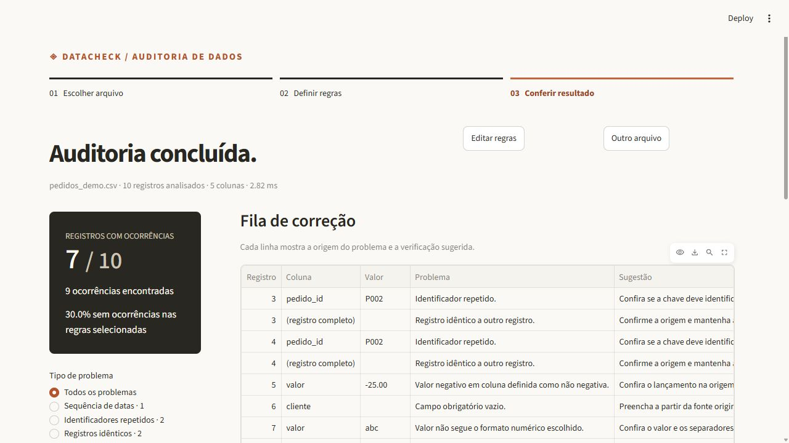
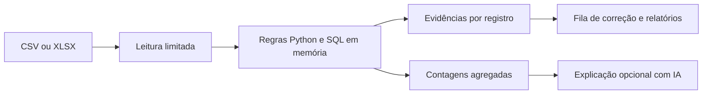

# DataCheck

**Encontre o problema, localize o registro e organize a correção.**

Uma planilha pode abrir normalmente e ainda conter duplicatas, campos vazios ou datas impossíveis. O DataCheck recebe CSV ou Excel, aplica regras configuráveis e mostra a origem de cada ocorrência. O fluxo segue três etapas: **Escolher arquivo → Definir regras → Conferir resultado**.



[Estudo de caso](docs/ESTUDO_DE_CASO.md) · [Resultado da demonstração](reports/demo/relatorio.json) · [Benchmark](reports/benchmark.json)

## Experimente

Na raiz do projeto, instale as dependências e abra o aplicativo. No Windows:

```powershell
py -3.14 -m venv .venv
.\.venv\Scripts\python.exe -m pip install -r requirements.txt
.\.venv\Scripts\python.exe -m streamlit run app.py --server.port 8501 --server.showEmailPrompt false
```

Abra `http://127.0.0.1:8501`. A demonstração acompanha o código. As verificações, as evidências e os relatórios funcionam sem chave de API.

O projeto foi testado em Python 3.12 e a interface também foi executada localmente com Python 3.14. Em Linux/macOS:

```bash
python3 -m venv .venv
.venv/bin/python -m pip install -r requirements.txt
.venv/bin/python -m streamlit run app.py --server.port 8501 --server.showEmailPrompt false
```

## Uma auditoria em três passos

1. **Escolher arquivo:** use a demonstração ou envie seu CSV/XLSX. Defina o separador, a codificação ou a aba quando necessário.
2. **Definir regras:** escolha campos obrigatórios, identificador, colunas numéricas, valores não negativos, datas e uma sequência a comparar. Clique em **Validar dados**.
3. **Conferir resultado:** filtre a fila de correção, identifique os registros afetados e exporte as evidências ou o relatório.

**Editar regras** permite ajustar os critérios e refazer a análise. **Outro arquivo** inicia uma nova auditoria. As verificações preservam a base original; as sugestões orientam a conferência e a correção na origem.

## O que está implementado

| Recurso | Comportamento |
|---|---|
| Leitura tabular | CSV em UTF-8/Windows-1252 e uma aba de XLSX por execução |
| Regras configuráveis | Campos obrigatórios, duplicatas, números, valores negativos e datas |
| Evidência por registro | Posição, coluna, valor, regra, problema e sugestão |
| Fila de correção | Filtro por tipo de problema, diagnóstico e amostra dos dados originais |
| Relatórios | HTML para leitura, CSV de ocorrências e resultado/configuração em JSON |
| Automação em lote | Execução pelo terminal com regras exportadas da interface |
| API | Validação de arquivos por requisição multipart |
| Explicação com IA opcional | Organização das prioridades a partir de contagens agregadas |

## Demonstração verificável

A [base de exemplo](data/pedidos_demo.csv) contém dez pedidos fictícios. Com as regras demonstrativas, o resultado é **9 ocorrências em 7 registros**, com três registros sem ocorrências.

| Regra | Ocorrências |
|---|---:|
| Registro completamente idêntico | 2 |
| Identificador repetido | 2 |
| Campo obrigatório vazio | 1 |
| Número inválido | 1 |
| Valor negativo | 1 |
| Data inválida | 1 |
| Entrega anterior à compra | 1 |

As duplicatas sinalizam todos os participantes do grupo, incluindo o primeiro. Um registro pode apresentar mais de um problema; por isso, ocorrências e registros afetados têm totais diferentes. O percentual sem ocorrências considera somente as regras selecionadas.

O [relatório JSON da demonstração](reports/demo/relatorio.json) registra a posição e o valor de cada ocorrência, além da configuração utilizada.

## Critérios e formatos

| Critério | Regra aplicada |
|---|---|
| Obrigatoriedade | Texto vazio ou composto somente por espaços gera ocorrência |
| Identificador | Valores exatos repetidos são sinalizados; identificadores vazios ficam fora dessa regra |
| Registro idêntico | Todas as colunas precisam ter os mesmos valores exatos |
| Número em texto | Segue o padrão escolhido: `1,234.56` ou `1.234,56` |
| Valor não negativo | O número válido precisa ser maior ou igual a zero |
| Data em texto | Valida formato e calendário em `AAAA-MM-DD` ou `DD/MM/AAAA` |
| Sequência de datas | A data final deve ser posterior ou igual à inicial |

Números e datas vazios só geram ocorrência quando também são obrigatórios. Textos como `NA` e `NULL` são preservados. Duplicidade não normaliza espaços ou maiúsculas. Números nativos do Excel independem do separador textual; datas nativas são aceitas em ISO.

Em CSV, os separadores aceitos são vírgula, ponto e vírgula ou tabulação. A detecção automática pode ser substituída pela escolha explícita. Em XLSX, abas com fórmulas são recusadas; envie uma cópia com os valores das células. Símbolos monetários e notação científica não fazem parte dos formatos numéricos textuais aceitos.

### Limites de entrada

| Limite | Valor |
|---|---:|
| Arquivo | Até 10 MB |
| Registros | Até 50.000 |
| Colunas | Até 50 |
| Células | Até 500.000 |
| Caracteres por célula | Até 2.000 |
| Tamanho descompactado do XLSX | Até 30 MB e 1.000 entradas internas |

O cabeçalho é a posição 1 e o primeiro registro de dados é 2. Em CSV com campos multilinha, a posição lógica pode diferir da linha física. Linhas CSV completamente vazias são ignoradas.

## Relatórios e execução em lote

Na interface, **Exportar relatório e configuração** oferece:

| Saída | Finalidade |
|---|---|
| HTML | Relatório visual com resumo, diagnóstico, evidências e regras |
| CSV | Ocorrências para tratamento em planilha |
| JSON do resultado | Integrações e reprodução dos dados estruturados |
| JSON das regras | Reutilização da configuração em outras execuções |

O CSV neutraliza textos que podem ser interpretados como fórmulas em leitores de planilha. O JSON preserva os valores originais.

Com o ambiente instalado, execute na raiz do projeto:

```powershell
.\.venv\Scripts\python.exe -m datacheck data/pedidos_demo.csv --orders --output relatorio
.\.venv\Scripts\python.exe -m datacheck minha_base.csv --rules regras.json --delimiter ";" --output relatorio
```

O primeiro comando aplica as regras de pedidos. O segundo usa uma configuração exportada da interface. Sem `--orders` ou `--rules`, somente registros completamente idênticos são verificados. São criados `relatorio.html`, `relatorio.json` e `ocorrencias.csv` na pasta indicada.

## Desempenho medido

O [benchmark de referência](reports/benchmark.json) foi executado em Python 3.12.14/Windows, com mediana de três execuções em dados sintéticos.

| Registros | Leitura do CSV | Motor de validação | Ocorrências esperadas/encontradas |
|---|---:|---:|---:|
| 1.000 | 2,63 ms | 16,99 ms | 50 / 50 |
| 10.000 | 18,76 ms | 158,77 ms | 500 / 500 |
| 50.000 | 108,98 ms | **1.058,87 ms** | 2.500 / 2.500 |

As medições incluem leitura e validação separadamente, sem interface, exportação ou chamadas de IA. O resultado varia com a máquina e a base; economia de trabalho humano não foi medida.

Para reproduzir:

```powershell
.\.venv\Scripts\python.exe benchmark.py
```

## Explicação com IA opcional

O diagnóstico local funciona sem serviços externos. Para habilitar a explicação generativa, configure uma chave e um modelo compatível com saída estruturada no ambiente do servidor:

```powershell
$env:OPENAI_API_KEY = "sua-chave"
$env:OPENAI_MODEL = "modelo-compativel-com-saida-estruturada"
.\.venv\Scripts\python.exe -m streamlit run app.py --server.port 8501 --server.showEmailPrompt false
```

O aplicativo não carrega `.env` automaticamente. Mantenha a chave fora do repositório. A chamada depende de autorização e de um clique em **Gerar explicação com IA**.

São enviados somente total de registros, registros afetados, ocorrências e contagens por identificador de regra. Arquivo, valores das células e nomes das colunas não são enviados. A integração usa `store=False`, saída estruturada e validação dos identificadores de regras.

A explicação pode conter imprecisões; contagens e evidências determinísticas continuam sendo a referência. Os testes usam cliente simulado, sem chamada real ao provedor. Falhas na integração preservam o relatório local.

## API local

```powershell
.\.venv\Scripts\python.exe -m uvicorn datacheck.api:app --host 127.0.0.1 --port 8000
```

Documentação interativa: `http://127.0.0.1:8000/docs`.

| Rota | Finalidade |
|---|---|
| `GET /health` | Disponibilidade do serviço |
| `POST /audit` | Arquivo, configuração e retorno do diagnóstico em JSON |

`POST /audit` usa multipart com `file`, `rules` como JSON textual, `delimiter`, `encoding` e `sheet`, cujo índice começa em zero. A API executa a validação local; a explicação com IA é acionada pela interface.

## Testes

```powershell
.\.venv\Scripts\python.exe -m pip install -r requirements-dev.txt
.\.venv\Scripts\python.exe -m pytest -q
```

**45 testes** cobrem regras, posições dos registros, números, datas, CSV, XLSX, fórmulas, limites de entrada, escape de relatórios, API, execução em lote, navegação por etapas e contrato da integração de IA. O fluxo automatizado está em [`.github/workflows/tests.yml`](.github/workflows/tests.yml).

## Arquitetura



| Caminho | Responsabilidade |
|---|---|
| `app.py` | Fluxo de auditoria, configuração, resultado e exportação |
| `datacheck/io.py` | Leitura, formatos e limites de entrada |
| `datacheck/engine.py` | Regras, SQL em memória e evidências |
| `datacheck/reports.py` | Diagnóstico local e relatórios |
| `datacheck/ai.py` | Explicação generativa a partir de contagens |
| `datacheck/api.py` | Integração HTTP |
| `benchmark.py` | Geração sintética, verificação das ocorrências e medições |

O [estudo de caso](docs/ESTUDO_DE_CASO.md) reúne o problema, as decisões e as evidências de funcionamento. A demonstração usa dados fictícios. O processamento da interface fica em memória por sessão; a execução em lote grava os relatórios na pasta indicada. Interface e API não oferecem autenticação para hospedagem compartilhada; a exposição externa exige controle de acesso, limites de requisição e política de retenção.
